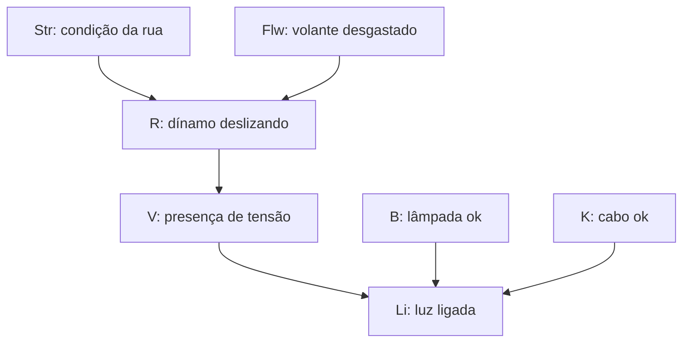

# Questão 1 — Item (a): rede bayesiana causal

**Pedido:** desenhar a rede de causalidade entre `Str`, `Flw`, `R`, `V`, `B`, `K` e `Li`.

## Variáveis

| Variável | Significado | Valores |
|---|---|---|
| $Str$ | Condição da rua | `dry`, `wet`, `snow_covered` |
| $Flw$ | Volante do dínamo desgastado | $t$, $f$ |
| $R$ | Dínamo deslizando | $t$, $f$ |
| $V$ | Dínamo apresenta tensão | $t$, $f$ |
| $B$ | Lâmpada em boas condições | $t$, $f$ |
| $K$ | Cabo em boas condições | $t$, $f$ |
| $Li$ | Luz ligada | $t$, $f$ |

Em todas as tabelas, $t$ significa verdadeiro e $f$, falso.

## Construção da rede

A condição da rua e o desgaste do volante afetam a aderência do dínamo. O deslizamento afeta a geração de tensão. A luz depende da tensão, da lâmpada e do cabo. Assim, adotamos a seguinte rede:

O conjunto de arestas é

$$
E=\{Str\to R,\ Flw\to R,\ R\to V,\ V\to Li,\ B\to Li,\ K\to Li\}.
$$

| Nó | Pais |
|---|---|
| $Str$, $Flw$, $B$, $K$ | Nenhum |
| $R$ | $Str$, $Flw$ |
| $V$ | $R$ |
| $Li$ | $V$, $B$, $K$ |

As condições $P(V\mid R,Str)=P(V\mid R)$ e $P(V\mid R,Flw)=P(V\mid R)$ são compatíveis com $R$ como único pai de $V$. Conhecido o deslizamento, rua e desgaste não acrescentam informação sobre a tensão no modelo. A condição $P(Li\mid V,R)=P(Li\mid V)$ é compatível com o efeito de $R$ sobre a luz sendo intermediado por $V$. A tabela de $Li$ fornecida no enunciado utiliza justamente $V$, $B$ e $K$ como pais.

## Hipótese de modelagem e fatoração

Adotei a interpretação causal descrita e a hipótese usual de **independência conjunta** dos nós de origem $Str$, $Flw$, $B$ e $K$. Essa hipótese é compatível com a independência aos pares do enunciado, mas é mais forte: independência aos pares, sozinha, não implica independência conjunta nem determina uma única rede.

A distribuição conjunta da rede escolhida se decompõe em

$$
\begin{aligned}
P(Str,Flw,R,V,B,K,Li)
={}&P(Str)P(Flw)P(B)P(K)\\
&\cdot P(R\mid Str,Flw)P(V\mid R)P(Li\mid V,B,K).
\end{aligned}
$$

Sem observar a luz, os caminhos que ligam $B$ ou $K$ à cadeia $Str,Flw,R,V$ passam pelo colisor $Li$ e ficam bloqueados. Isso explica as independências marginais $(R,B)$, $(R,K)$, $(V,B)$ e $(V,K)$.

**Resposta:** a rede tem sete nós e as seis arestas indicadas no diagrama; não há ciclos dirigidos.
