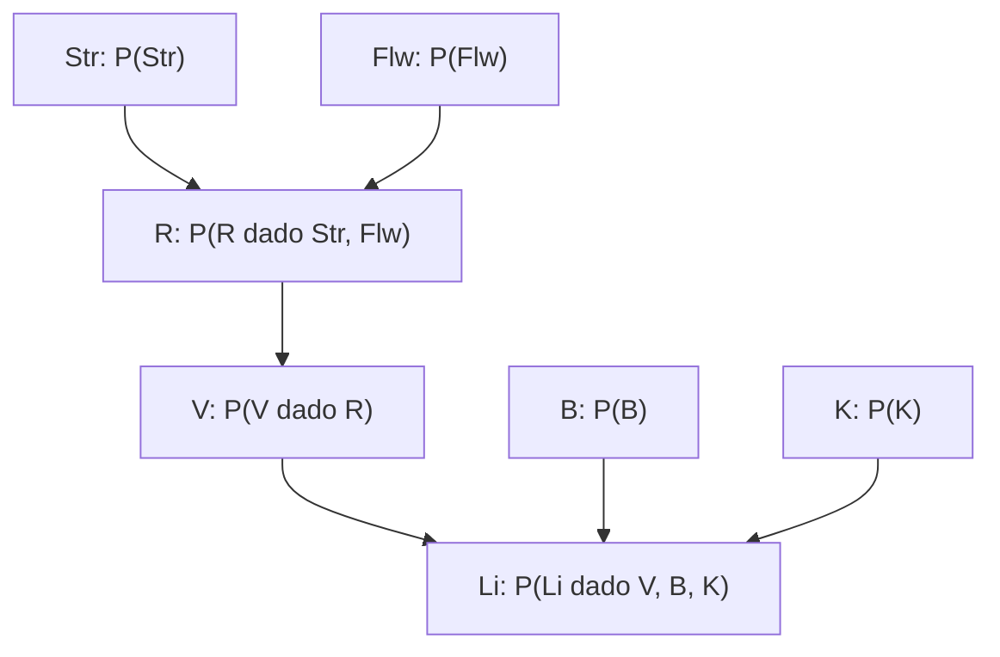

# Questão 1 — Item (b): tabelas de probabilidades

Cada nó precisa de uma distribuição condicionada aos seus pais. Para um nó sem pais, essa tabela é sua distribuição a priori.

Há **sete tabelas**. A CPT de $Li$ já consta do enunciado; faltam as seis distribuições de $Str$, $Flw$, $B$, $K$, $R$ e $V$. Abaixo estão suas formas gerais. As escolhas numéricas são desenvolvidas no [item (c)](item-c.md).

## 1. Distribuição de $Str$

| $Str$ | Probabilidade |
|---|---:|
| `dry` | $p_d$ |
| `wet` | $p_w$ |
| `snow_covered` | $p_s$ |

Os parâmetros devem satisfazer $p_d,p_w,p_s\geq 0$ e $p_d+p_w+p_s=1$.

## 2–4. Distribuições de $Flw$, $B$ e $K$

Definimos $\alpha=P(Flw=t)$, $\beta=P(B=t)$ e $\gamma=P(K=t)$.

| Nó | $P(t)$ | $P(f)$ |
|---|---:|---:|
| $Flw$ | $\alpha$ | $1-\alpha$ |
| $B$ | $\beta$ | $1-\beta$ |
| $K$ | $\gamma$ | $1-\gamma$ |

Cada parâmetro pertence ao intervalo $[0,1]$.

## 5. CPT de $R$

Definimos $r_{s,w}=P(R=t\mid Str=s,Flw=w)$.

| $Str$ | $Flw$ | $P(R=t\mid Str,Flw)$ | $P(R=f\mid Str,Flw)$ |
|---|---|---:|---:|
| `dry` | $f$ | $r_{dry,f}$ | $1-r_{dry,f}$ |
| `dry` | $t$ | $r_{dry,t}$ | $1-r_{dry,t}$ |
| `wet` | $f$ | $r_{wet,f}$ | $1-r_{wet,f}$ |
| `wet` | $t$ | $r_{wet,t}$ | $1-r_{wet,t}$ |
| `snow_covered` | $f$ | $r_{snow,f}$ | $1-r_{snow,f}$ |
| `snow_covered` | $t$ | $r_{snow,t}$ | $1-r_{snow,t}$ |

O índice $snow$ abrevia o valor `snow_covered`. São $3\times2=6$ combinações dos pais e seis parâmetros livres, todos em $[0,1]$.

## 6. CPT de $V$

Definimos $v_r=P(V=t\mid R=r)$.

| $R$ | $P(V=t\mid R)$ | $P(V=f\mid R)$ |
|---|---:|---:|
| $f$ | $v_f$ | $1-v_f$ |
| $t$ | $v_t$ | $1-v_t$ |

São duas combinações do único pai e dois parâmetros livres em $[0,1]$.

## 7. CPT de $Li$ fornecida no enunciado

Interpretamos a coluna $P(Li)$ da tabela original como $P(Li=t\mid V,B,K)$. Preservamos os oito valores fornecidos e acrescentamos os complementos para $Li=f$.

| $V$ | $B$ | $K$ | $P(Li=t\mid V,B,K)$ | $P(Li=f\mid V,B,K)$ |
|---|---|---|---:|---:|
| $t$ | $t$ | $t$ | $0{,}99$ | $0{,}01$ |
| $t$ | $t$ | $f$ | $0{,}01$ | $0{,}99$ |
| $t$ | $f$ | $t$ | $0{,}01$ | $0{,}99$ |
| $t$ | $f$ | $f$ | $0{,}001$ | $0{,}999$ |
| $f$ | $t$ | $t$ | $0{,}30$ | $0{,}70$ |
| $f$ | $t$ | $f$ | $0{,}005$ | $0{,}995$ |
| $f$ | $f$ | $t$ | $0{,}005$ | $0{,}995$ |
| $f$ | $f$ | $f$ | $0$ | $1$ |

São $2^3=8$ combinações dos pais. Para qualquer variável booleana $X$, o complemento decorre de

$$
P(X=f\mid\text{pais})=1-P(X=t\mid\text{pais}).
$$

**Resposta:** as sete tabelas ficam associadas aos nós como no diagrama; suas linhas somam 1. O total de parâmetros livres da estrutura é $2+1+1+1+6+2+8=21$, dos quais oito já foram fixados pela CPT de $Li$ do enunciado.
